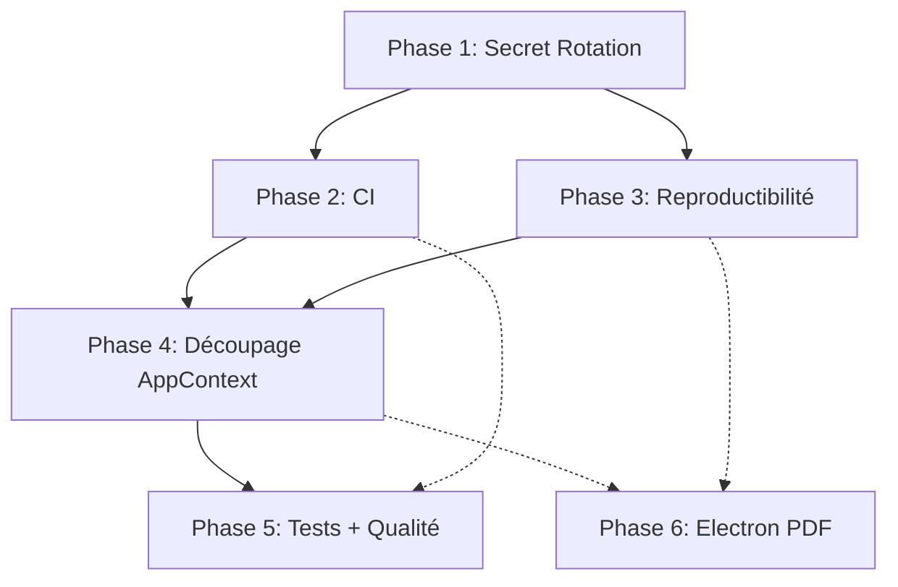

# Plan d'Implémentation — Santé du Code ScoutRaider

> Basé sur l'audit de santé du code (corrections + plan priorisé)
> Date : 2026-11-17

---

## Résumé des priorités

| Niveau | Description | Effort estimé |
|--------|-------------|---------------|
| **P0** | Rotation secret Postgres + purge historique Git | 2–4 h |
| **P1** | CI complète (lint, typecheck, tests, npm ci) | 1–2 j |
| **P1** | Fix reproductibilité install (Mantine/Blocknote, engines, npm ci) | 4–8 h |
| **P2** | Découpage `AppContext` (reducers + contextes + sélecteurs) | 1–2 sem |
| **P2** | Tests Vitest sur `src/logic/` + ESLint/Prettier | 3–5 j |
| **P3** | Repli Electron `printToPDF` réel (ou suppression UI) | 2–3 j |

---

## Phase 0 — Préparation (30 min)

### Tâche 0.1 : Créer la branche de travail
```bash
git checkout -b chore/health-audit-fixes
```

### Tâche 0.2 : Documenter l'état actuel
- [ ] Commit de référence : `git log --oneline -1`
- [ ] Lister les fichiers modifiés récents : `git diff --name-only HEAD~5`
- [ ] Screenshot package-lock.json hash

**Critère de validation** : Branche créée, point de départ tracé.

---

## Phase 1 — P0 : Rotation Secret Postgres (Critique — Aujourd'hui)

### Tâche 1.1 : Générer nouveau mot de passe Postgres
- [ ] Générer un mot de passe fort (ex: `openssl rand -base64 32`)
- [ ] Noter le nouveau secret dans un gestionnaire de mots de passe sécurisé

### Tâche 1.2 : Mettre à jour l'infrastructure
- [ ] **Supprimer** `DEFAULT_PG_URL` de `backend/app/db.py:16`
- [ ] **Supprimer** `DATABASE_URL` du `Dockerfile:15`
- [ ] Modifier `db.py` pour **exiger** `DATABASE_URL` via `os.getenv("DATABASE_URL")` sans défaut → fail-fast si absent
- [ ] Mettre `DEBUG=false` dans le Dockerfile (ligne ENV)

### Tâche 1.3 : Rotation sur le serveur de production
- [ ] Changer le mot de passe sur l'instance PostgreSQL (Supabase / Railway / self-hosted)
- [ ] Définir la variable d'environnement `DATABASE_URL` sur le serveur avec la nouvelle valeur
- [ ] Redémarrer le service backend pour prise en compte

### Tâche 1.4 : Purge de l'historique Git (BFG / git-filter-repo)
```bash
# Option A : BFG Repo-Cleaner (plus rapide)
java -jar bfg.jar --replace-text passwords.txt

# Option B : git-filter-repo (recommandé GitHub)
pip install git-filter-repo
git filter-repo --replace-text passwords.txt --force
```
- [ ] Créer `passwords.txt` avec l'ancien mot de passe → nouveau (ou suppression)
- [ ] Force-push : `git push origin --force --all` + `git push origin --force --tags`
- [ ] **Vérifier** : `git log --all --full-history -- backend/app/db.py Dockerfile` ne montre plus le secret

### Tâche 1.5 : Invalider les tokens GitHub si exposé
- [ ] Settings → Developer settings → Personal access tokens → Révoquer / régénérer
- [ ] Vérifier les Deploy keys / secrets du repo

**Critères de validation** :
- [ ] Aucun secret en dur dans `db.py` ni `Dockerfile`
- [ ] `DATABASE_URL` requis au runtime (échec explicite si absent)
- [ ] Historique Git purgé (vérifié sur 2-3 commits sensibles)
- [ ] Production fonctionnelle avec nouveau mot de passe

**Estimation** : 2–4 h (dépend de la complexité de la purge historique)

---

## Phase 2 — P1 : CI Complète (Cette semaine)

### Tâche 2.1 : Créer `.github/workflows/ci.yml`
```yaml
name: CI
on:
  pull_request:
    branches: [main, develop]
  push:
    branches: [main]

env:
  NODE_VERSION: '20'
  PYTHON_VERSION: '3.11'

jobs:
  frontend:
    runs-on: ubuntu-latest
    defaults:
      run:
        working-directory: .
    steps:
      - uses: actions/checkout@v4
      - uses: actions/setup-node@v4
        with:
          node-version: ${{ env.NODE_VERSION }}
          cache: 'npm'
      - run: npm ci
      - run: npm run typecheck
      - run: npm run lint
      - run: npm run build

  backend:
    runs-on: ubuntu-latest
    defaults:
      run:
        working-directory: backend
    steps:
      - uses: actions/checkout@v4
      - uses: actions/setup-python@v5
        with:
          python-version: ${{ env.PYTHON_VERSION }}
          cache: 'pip'
      - run: pip install -r requirements.txt
      - run: pytest tests/ -v --tb=short

  docker:
    runs-on: ubuntu-latest
    needs: [frontend, backend]
    steps:
      - uses: actions/checkout@v4
      - uses: docker/build-push-action@v5
        with:
          context: .
          push: false
          tags: scoutraider:test
```

### Tâche 2.2 : Ajouter scripts dans `package.json`
```json
{
  "scripts": {
    "typecheck": "tsc --noEmit",
    "lint": "eslint src --ext .ts,.tsx",
    "format": "prettier --write src",
    "test": "vitest run",
    "build": "vite build",
    "ci": "npm run typecheck && npm run lint && npm run test && npm run build"
  }
}
```

### Tâche 2.3 : Configurer ESLint + Prettier
- [ ] `npm i -D eslint @typescript-eslint/parser @typescript-eslint/eslint-plugin eslint-plugin-react-hooks prettier eslint-config-prettier`
- [ ] Créer `.eslintrc.cjs` (config TypeScript + React + Prettier)
- [ ] Créer `.prettierrc` (config projet)
- [ ] Ajouter `.eslintignore` (exclure `dist/`, `node_modules/`, `*.config.*`)

### Tâche 2.4 : Configurer Vitest
- [ ] `npm i -D vitest @vitest/ui jsdom @testing-library/react`
- [ ] Créer `vitest.config.ts`
- [ ] Écrire premiers tests sur `src/logic/` (CarnetEngine, ConstraintChecker, GeoUtils)

### Tâche 2.5 : Fixer `backend/requirements.txt`
- [ ] Ajouter `pytest` + `pytest-cov` + `httpx` (pour tests FastAPI)
- [ ] Vérifier que `pytest tests/ -v` passe en local

### Tâche 2.6 : Passer la CI existante (`release.yml`) en `npm ci`
- [ ] Remplacer `npm install` par `npm ci` dans `release.yml`
- [ ] Ajouter `engines` dans `package.json` :
```json
"engines": {
  "node": ">=20.0.0 <21",
  "npm": ">=10.0.0 <11"
}
```

### Tâche 2.7 : Résoudre conflit Mantine / Blocknote
**Option A (recommandée)** : Mettre à jour `@mantine/core` vers `^9.0.2` ou compatible
- [ ] Vérifier breaking changes Mantine v8→v9
- [ ] Migrer composants si nécessaire
- [ ] Tester build complet

**Option B (temporaire)** : Documenter `--legacy-peer-deps` dans README + CI
- [ ] Ajouter dans `ci.yml` : `npm ci --legacy-peer-deps`
- [ ] Note dans README : "Conflit peer deps connu, migration Mantine v9 prévue"

**Critères de validation** :
- [ ] `ci.yml` passe sur PR (lint + typecheck + tests frontend + tests backend + build)
- [ ] `npm ci` reproductible (même lockfile)
- [ ] `release.yml` utilise `npm ci`
- [ ] Conflit Mantine résolu ou documenté avec workaround
- [ ] `engines` épinglé

**Estimation** : 1–2 jours

---

## Phase 3 — P1 : Reproductibilité Install (Cette semaine)

### Tâche 3.1 : Nettoyer `package.json`
- [ ] Supprimer `vite-plugin-electron` si inutilisé (vérifier `vite.config.js`)
- [ ] Vérifier toutes les `devDependencies` / `dependencies` utilisées
- [ ] Supprimer `dist/` du repo (ajouter au `.gitignore`)

### Tâche 3.2 : Mettre à jour `.gitignore`
```
dist/
*.local
.env
.env.*
!.env.example
node_modules/
backend/__pycache__/
backend/.pytest_cache/
*.log
```

### Tâche 3.3 : Nettoyer l'historique `dist/` (optionnel, si gros)
- [ ] `git filter-repo --path dist/ --invert-paths` (si dossier volumineux)
- [ ] Force-push

### Tâche 3.4 : Dockerfile — Build au lieu de copier `dist/`
```dockerfile
# Avant (copie dist/ commité)
COPY dist/ ./dist/

# Après (build dans l'image)
COPY package*.json ./
RUN npm ci
COPY . .
RUN npm run build
```

**Critères de validation** :
- [ ] `dist/` absent du repo
- [ ] `npm ci` + `npm run build` reproductible en CI
- [ ] Dockerfile build l'app, ne copie pas `dist/`
- [ ] Image Docker fonctionnelle

**Estimation** : 4–8 h

---

## Phase 4 — P2 : Découpage `AppContext` (Sprint suivant)

### Architecture cible
```
src/
├── context/
│   ├── AppContext.tsx          # Provider principal (léger)
│   ├── RoutesContext.tsx       # État routes/itinéraires
│   ├── AnnotationsContext.tsx  # État annotations/marqueurs
│   ├── CarnetContext.tsx       # État carnet/entrées
│   └── UIContext.tsx           # État UI (modales, panels, thème)
├── logic/
│   ├── reducers/
│   │   ├── routesReducer.ts
│   │   ├── annotationsReducer.ts
│   │   ├── carnetReducer.ts
│   │   └── uiReducer.ts
│   └── selectors/
│       ├── routesSelectors.ts
│       ├── annotationsSelectors.ts
│       └── ...
└── hooks/
    ├── useRoutes.ts
    ├── useAnnotations.ts
    ├── useCarnet.ts
    └── useUI.ts
```

### Tâche 4.1 : Extraire les reducers (102 cases → 4-5 reducers)
- [ ] Créer `src/logic/reducers/routesReducer.ts` (cases liées aux routes/GPX/itinéraires)
- [ ] Créer `src/logic/reducers/annotationsReducer.ts` (marqueurs, POI, couches)
- [ ] Créer `src/logic/reducers/carnetReducer.ts` (entrées carnet, médias, tags)
- [ ] Créer `src/logic/reducers/uiReducer.ts` (modales, sidebars, thème, undo/redo)
- [ ] Créer `src/logic/reducers/index.ts` (combineReducers style)

### Tâche 4.2 : Créer contextes spécialisés + sélecteurs
- [ ] `RoutesContext.tsx` + `useRoutes()` + `routesSelectors.ts`
- [ ] `AnnotationsContext.tsx` + `useAnnotations()` + `annotationsSelectors.ts`
- [ ] `CarnetContext.tsx` + `useCarnet()` + `carnetSelectors.ts`
- [ ] `UIContext.tsx` + `useUI()` + `uiSelectors.ts`

### Tâche 4.3 : Refactor `AppContext.tsx` → Provider compositeur
- [ ] Garder `AppProvider` qui wrap les 4 contextes
- [ ] Exposer `useApp()` legacy qui combine (pour migration progressive)
- [ ] Supprimer `appReducer` monolithique, `AppAction`, `historyStack` module-level

### Tâche 4.4 : Migrer les 60 appels `useApp()` vers sélecteurs ciblés
- [ ] Audit : `grep -r "useApp()" src/` → lister les 45 fichiers
- [ ] Par fichier : remplacer `const { state, dispatch } = useApp()` par `useRoutes()`, `useAnnotations()`, etc.
- [ ] Vérifier que plus aucun composant ne re-render globalement

### Tâche 4.5 : Undo/Redo — déplacer dans logique
- [ ] Créer `src/logic/UndoManager.ts` (classe générique)
- [ ] Intégrer dans chaque reducer concerné ou context UI

**Critères de validation** :
- [ ] `AppContext.tsx` < 500 lignes (vs 2826)
- [ ] 4 contextes spécialisés fonctionnels
- [ ] `useApp()` legacy optionnel, nouveaux hooks utilisés
- [ ] Plus de re-rendu global à chaque dispatch (vérifier React DevTools Profiler)
- [ ] Tests Vitest sur chaque reducer + sélecteurs

**Estimation** : 1–2 semaines

---

## Phase 5 — P2 : Tests + Qualité Code (Parallèle Phase 4)

### Tâche 5.1 : Tests Vitest sur `src/logic/` (priorité haute)
| Module | Type | Tests ciblés |
|--------|------|--------------|
| `CarnetEngine` | Pur | CRUD entrées, filtres, recherche, import/export |
| `ConstraintChecker` | Pur | Règles métier, validation géométrique |
| `GeoUtils` | Pur | Calculs distance, bearing, projection, conversion |
| `StateManager` | Pur | Transitions, cohérence état |
| `Orchestrator` | Intégration | Workflows multi-modules |
| `LayerOrder` | Pur | Z-index, visibilité, groupement |
| `ModuleLogic` | Pur | Activation/désactivation modules |

- [ ] Cible : >80% couverture sur `src/logic/`
- [ ] Tests snapshots pour reducers

### Tâche 5.2 : ESLint + Prettier sur tout le frontend
- [ ] `npm run lint` → 0 erreur, 0 warning (ou warnings documentés)
- [ ] `npm run format` → code formaté
- [ ] Pre-commit hook (husky + lint-staged) optionnel

### Tâche 5.3 : Arrêter de commiter `dist/`
- [ ] Vérifier `.gitignore` mis à jour (Phase 3)
- [ ] Supprimer `dist/` de l'index : `git rm -r --cached dist/`
- [ ] Commit : `chore: remove dist from repo`

**Critères de validation** :
- [ ] Vitest passe (`npm run test`)
- [ ] Couverture >80% sur `src/logic/`
- [ ] ESLint clean
- [ ] `dist/` absent du repo

**Estimation** : 3–5 jours (peut se faire en parallèle Phase 4)

---

## Phase 6 — P3 : Repli Electron `printToPDF` (Plus tard)

### Option A : Implémenter `printToPDF` réel (recommandé)
**Fichiers à modifier** :
- `electron/main.js` : ajouter handler `print-to-pdf`
- `src/logic/ExportService.ts` : utiliser `engine` param

```javascript
// electron/main.js
ipcMain.handle('print-to-pdf', async (event, { html, options }) => {
  const win = new BrowserWindow({ show: false, webPreferences: { offscreen: true } })
  await win.loadURL(`data:text/html,${encodeURIComponent(html)}`)
  const pdf = await win.webContents.printToPDF(options)
  win.close()
  return pdf
})
```

```typescript
// ExportService.ts
async exportPDF(html: string, name: string, engine: 'weasyprint' | 'electron') {
  if (engine === 'electron' && isElectron()) {
    const pdf = await ipcRenderer.invoke('print-to-pdf', { html, options: { ... } })
    return savePDF(pdf, name)
  }
  // fallback WeasyPrint existant
}
```

### Option B : Embarquer WeasyPrint via PyInstaller
- [ ] Créer `backend/renderer/weasyprint_wrapper.py` (CLI minimal)
- [ ] `pyinstaller --onefile weasyprint_wrapper.py`
- [ ] Embarquer binaire dans `extraResources` Electron
- [ ] Modifier `ExportService` pour appeler le binaire

### Option C : Supprimer l'option « Electron » de l'UI
- [ ] Retirer le bouton/choix dans `ExportPanel.tsx:229`
- [ ] Documenter : "Export PDF via backend WeasyPrint uniquement"

**Critères de validation** :
- [ ] Option « Electron » fonctionnelle **OU** retirée de l'UI
- [ ] Export PDF desktop fonctionne sans Python/WeasyPrint installé utilisateur
- [ ] Tests manuels : export carnet, export itinéraire, export annotation

**Estimation** : 2–3 jours

---

## Dépendances entre phases



- **P0** : Bloquant (sécurité) — à faire **immédiatement**
- **P1 + P3** : Peuvent se faire en parallèle (CI + reproductibilité)
- **P4 + P5** : Peuvent se faire en parallèle (refactor + tests)
- **P6** : Indépendant, peut attendre

---

## Checklist globale de validation

### Sécurité (P0)
- [ ] Secret Postgres roté + purgé de l'historique
- [ ] `DATABASE_URL` requis au runtime
- [ ] `DEBUG=false` en prod
- [ ] Tokens GitHub régénérés

### CI/CD (P1)
- [ ] `ci.yml` sur PR + push main
- [ ] `npm ci` + `tsc --noEmit` + `eslint` + `vitest` + `vite build`
- [ ] `pytest backend/app/tests` vert
- [ ] `release.yml` utilise `npm ci`
- [ ] `engines` épinglé Node 20 / npm 10
- [ ] Conflit Mantine résolu ou documenté

### Reproductibilité (P1)
- [ ] `dist/` hors repo + `.gitignore`
- [ ] Dockerfile build l'app
- [ ] `npm ci` reproductible local + CI

### Architecture Frontend (P2)
- [ ] `AppContext.tsx` < 500 lignes
- [ ] 4 contextes spécialisés + sélecteurs
- [ ] Plus de re-rendu global
- [ ] Undo/Redo dans logique

### Tests + Qualité (P2)
- [ ] Vitest >80% couverture `src/logic/`
- [ ] ESLint clean
- [ ] Prettier appliqué
- [ ] `dist/` non commité

### Electron PDF (P3)
- [ ] Option Electron fonctionnelle **OU** retirée

---

## Ordre d'exécution recommandé

| Semaine | Focus | Livrables |
|---------|-------|-----------|
| **Semaine 1** (immédiat) | P0 + P1 (CI) | Secret roté, CI verte sur PR |
| **Semaine 1-2** | P3 (Reproductibilité) | `dist/` clean, Dockerfile build, Mantine fixé |
| **Semaine 2-3** | P4 (Découpage AppContext) | 4 contextes, sélecteurs, hooks |
| **Semaine 3-4** | P5 (Tests + Qualité) | Vitest >80%, ESLint clean, Prettier |
| **Semaine 4-5** | P6 (Electron PDF) | PrintToPDF réel ou UI nettoyée |

---

## Notes pour l'équipe

1. **P0 est non-négociable** — le repo est public avec un secret en production dans l'historique. Traiter en priorité absolue.
2. **CI avant refactor** — la CI (P1) filet de sécurité pour le gros refactor AppContext (P4).
3. **Tests d'abord sur `src/logic/`** — modules purs, sans DOM, ROI immédiat.
4. **Migration progressive `useApp()`** — ne pas tout casser d'un coup ; `useApp()` legacy peut cohabiter le temps de migrer les 45 fichiers.
5. **Electron PDF** — si l'option « Electron » est censée être le fallback desktop, l'implémenter **vraiment** (Option A). Sinon, l'enlever (Option C) pour ne pas mentir à l'utilisateur.

---

## Commandes utiles

```bash
# Vérifier secret dans l'historique
git log --all --full-history -- backend/app/db.py Dockerfile

# Trouver tous les useApp()
grep -r "useApp()" src/ --include="*.tsx" | wc -l

# Vérifier taille AppContext
wc -l src/context/AppContext.tsx

# Test CI local (act)
act push -W .github/workflows/ci.yml

# Build Docker local
docker build -t scoutraider:local .
```

---

*Plan généré à partir de l'audit de santé du code — à ajuster selon retours équipe et contraintes calendrier.*