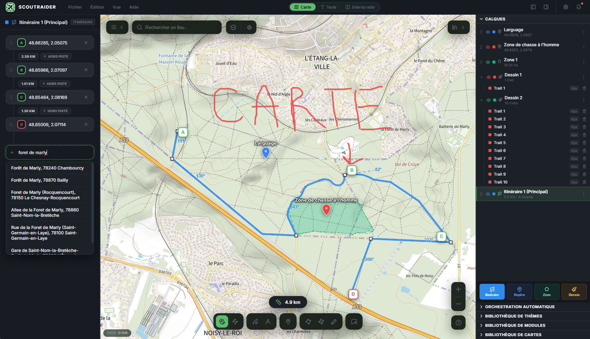
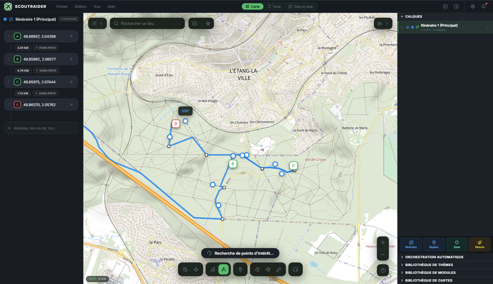

# ScoutRaider — Générateur de Carnets de Raid

Version Beta 0.3.8-beta · Application de planification de raids scouts, disponible sur navigateur et en application de bureau.

## 📸 Démo — Ce que l'app peut faire

Trois captures d'écran illustrent le flux complet, du tracé à l'instruction générée :

### 1. Génération d'itinéraire & azimuts

*Tracer un itinéraire sur la carte → ScoutRaider calcule automatiquement les distances, azimuts et capes. C'est ici que le "vrai itinéraire" est relié par les routes/sentiers réels (routage BRouter).*

### 2. Édition fine du chemin & ajustage

*Ajustage manuel du tracé et des azimuts. Vous gardez le contrôle total : déplacer un point, affiner un angle, changer la finesse de virage, tout se régénère instantanément.*

### 3. Instructions codifiées & Morse

*Les instructions de navigation sont générées à partir des données réelles du terrain (points d'intérêt, noms de lieux), puis codifiées avec les modules choisis (Morse, Vigenère, Avocat, etc.). Le carnet s'édite librement après génération.*

---

---