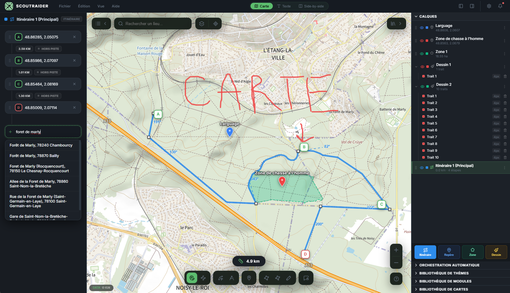
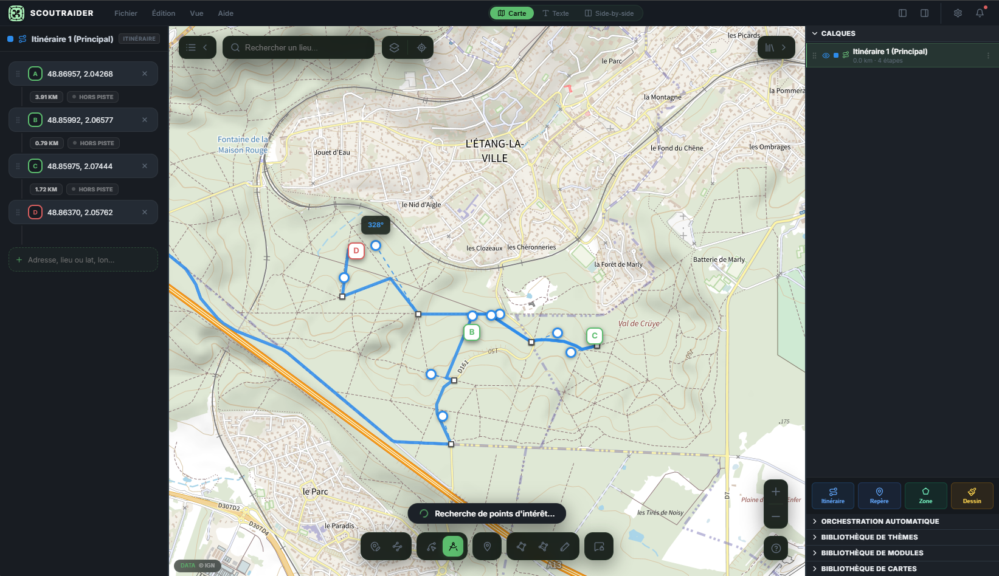
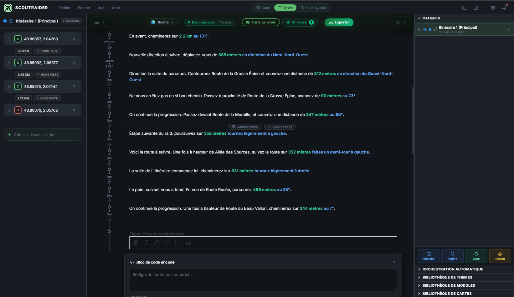

  

# ScoutRaider — Générateur de Carnets de Raid (Repository Blueprint)

> **Version Beta 0.3.11** · Application de planification de raids scouts, disponible sur navigateur et en application de bureau (Electron).

---

## System Overview

ScoutRaider is a dual-target (Web Single-Page App & Electron Desktop) suite engineered for scout leaders to plan hiking itineraries, calculate topological navigation legs (distances, bearings, azimuths, and elevation profiles), encode cryptographic trail challenges (Morse, Vigenère, Avocat, etc.), and compile print-ready expedition logbooks (*carnets de raid*) into PDF, HTML, and CSV.

The repository is organized into four primary architectural subsystems:
1. **Frontend (`src/`)**: Modern React 18 + TypeScript + Vite SPA featuring interactive Leaflet/OpenLayers mapping, vector annotations, carnet text editors, and client-side puzzle algorithms.
2. **Desktop Runtime (`electron/`)**: Electron wrapper providing secure context isolation, offline filesystem persistence (`.srdoc`, `.scoutproj`), and desktop WeasyPrint execution.
3. **Cloud Backend (`backend/`)**: Asynchronous FastAPI + PostgreSQL 16 + SQLAlchemy 2.0 + Garage S3 service providing cloud document synchronization, asset management, and server-side PDF generation.
4. **Legacy Core (`legacy/`)**: Historical Python 3.9 + PySide6 desktop application providing reference algorithms for BRouter routing, polygonization, and classic raid themes.

---

## Local Interface & Invariants

### Root Configuration Scripts
- `vite.config.js`: Vite build and development configuration configuring `@vitejs/plugin-react`, path aliases (`@/` mapping to `src/`), and dev server port proxies.
- `start.sh`: Shell launcher initiating concurrent backend (`uvicorn app.main:app`) and frontend development servers.
- `package.json`: Main manifest orchestrating npm scripts for web and electron builds (`dev`, `build`, `electron`, `electron:dev`, `electron:build:win`).

### Local Invariants
- Node runtime dependencies must support ES Module syntax (`"type": "module"` in `package.json`).
- Build artifacts (`dist/`, `dist_electron/`) and sensitive local credentials (`.env`) are strictly excluded from VCS commits.

---

## Subdirectories & System Boundaries

- **[backend](./backend/README.md)**: Asynchronous FastAPI backend service providing REST API endpoints (`/api/auth`, `/api/documents`, `/api/assets`, `/api/export`), PostgreSQL schema migrations via Alembic, and Garage S3 asset storage.
- **[electron](./electron/README.md)**: Electron main process lifecycle (`electron/main.js`) and secure preload context bridge (`electron/preload.js`) managing frameless windowing, OS file associations, native dialogs, and local WeasyPrint PDF pipelines.
- **[legacy](./legacy/README.md)**: Offline Python/PySide6 desktop application and algorithm suite containing polygonal segmentation, BRouter client helpers, and 12 cipher encoding modules.
- **[src](./src/README.md)**: React TypeScript frontend source tree containing UI layout components, map workspace, carnet textual blocks, logic engines, and module registries.

---

## Global Invariants

- **Document Model Compatibility**: Projects adhere to DocumentV2 schema specifications (`.srproj` ZIP archives with `manifest.json` and `.srdoc` legacy documents). Migrations must ensure lossless conversion between client-side state and backend models.
- **Context Isolation & Security**: Desktop runtime strictly enforces `contextIsolation: true` and `nodeIntegration: false`. No Node.js APIs may be invoked directly from frontend renderer scripts.
- **API Standards & User-Agent Compliance**: All external Overpass API requests must supply custom user-agent headers to comply with OpenStreetMap usage policies and prevent HTTP 406/429 rate-limiting.
- **Optimistic Concurrency Control**: Document modifications against the cloud backend require revision version checks (`If-Match` headers) to prevent silent overwrite of concurrent edits.

---

## Global Side Effects

- **Filesystem Persistence**: Local read/write operations for project documents (`.srdoc`, `.scoutproj`, `.srproj`), exported PDFs, and temporary compilation HTML files in OS temp directories.
- **Database & Object Storage**: Persistent storage in PostgreSQL 16 (relational document and user models) and S3-compatible object storage (Garage S3 / MinIO) for media assets and fonts.
- **External Cartography Services**: Outbound network requests to OpenStreetMap Overpass API, IGN Geoservices, Mapy.cz, and public BRouter routing instances.

---

## System Verification

- **Frontend Build**: `npm run build`
- **Desktop Electron**: `npm run electron`
- **Backend Test Suite**: `cd backend && pytest tests/ -v`
- **Full Production Packaging**: `npm run electron:build:win`

---

## 📸 Démo & Fonctionnalités

### 1. Génération d'itinéraire & azimuts

*Tracer un itinéraire sur la carte → ScoutRaider calcule automatiquement les distances, azimuts et caps.*

### 2. Édition fine du chemin & ajustage

*Ajustage manuel du tracé et des azimuts avec déplacement des points et régénération instantanée.*

### 3. Instructions codifiées & Morse

*Génération de consignes thématisées à partir des points d'intérêt réels et chiffrement par modules (Morse, Vigenère, Avocat, etc.).*
