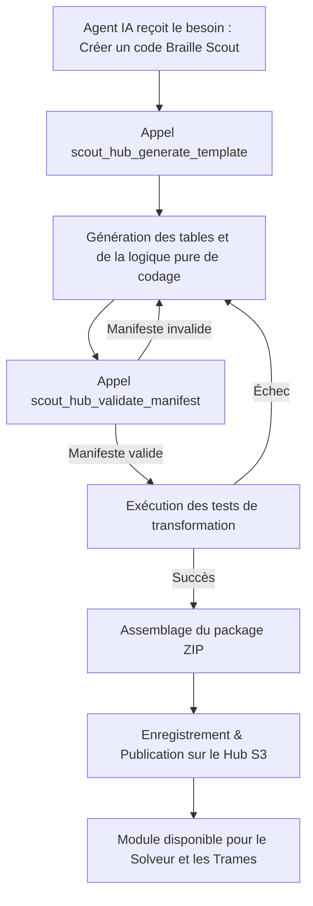

# Spécification Technique : Architecture « Agent-First » & Protocole MCP
*Exposition du Hub ScoutRaider pour les Agents IA & Automatisation Complète de la Création de Modules*

---

## 1. Philosophie « Agent-First »

Le Hub ScoutRaider v2.0 est conçu selon le paradigme **Agent-First** : chaque ressource, manifeste, contrainte et point de terminaison est instrumenté pour être directement découvrable, intelligible, manipulable et extensible par un agent autonome (LLM) sans friction ni intervention humaine.

Concrètement, un agent IA connecté à ScoutRaider peut :
1. **Consulter l'inventaire** des ressources, comprendre les capacités d'encodage (`map_path`, `numeric`, `alphabetic`, etc.) et identifier les manques ou les besoins d'un scénario de jeu.
2. **Résoudre automatiquement les dépendances** d'une Trame de Raid en téléchargeant les modules manquants depuis S3.
3. **Créer de A à Z un nouveau module conforme** (ex: Code Polybe 3D, Chiffre des Templiers étendu, Fond de carte local Swisstopo/IGN), en générant le code, le manifest v2, les assets, en validant le tout via les outils de l'API Hub et en publiant l'archive ZIP.

---

## 2. Définition des Outils MCP (Model Context Protocol)

Le serveur MCP (`backend/app/mcp/server.py`) expose les 5 outils spécialisés suivants :

### 2.1 `scout_hub_query_catalog`
Permet à l'agent d'explorer le catalogue du Hub selon des critères précis.

- **Schéma d'Entrée (`inputSchema`)** :
```json
{
  "type": "object",
  "properties": {
    "resource_type": {
      "type": "string",
      "enum": ["all", "crypto_module", "map_provider", "raid_trame", "theme_style", "syntax_extension"],
      "description": "Filtrer par type de ressource."
    },
    "capability": {
      "type": "string",
      "enum": ["all", "map_path", "numeric", "alphabetic", "alphanumeric", "symbolic_visual"],
      "description": "Filtrer les modules de chiffrement par capacité de données."
    },
    "query": {
      "type": "string",
      "description": "Recherche textuelle libre (nom, description, mots-clés)."
    },
    "target_level": {
      "type": "string",
      "enum": ["louveteaux", "seconde_classe", "premiere_classe", "raider"],
      "description": "Filtrer selon le niveau pédagogique scout visé."
    }
  }
}
```

- **Sortie Attendue** : Liste d'objets synthétiques avec `id`, `name`, `version`, `resource_type`, `data_capability`, `rating`, `download_url` et statut d'installation local.

---

### 2.2 `scout_hub_get_manifest`
Récupère le manifeste complet et le schéma d'un module donné.

- **Schéma d'Entrée** :
```json
{
  "type": "object",
  "properties": {
    "module_id": {
      "type": "string",
      "description": "Identifiant unique du module ou de la ressource."
    }
  },
  "required": ["module_id"]
}
```

- **Sortie** : JSON complet du `manifest.json` avec l'URL du `$schema` et la liste des assets disponibles.

---

### 2.3 `scout_hub_validate_manifest`
Permet à l'agent de soumettre un manifeste avant écriture pour validation formelle et détection immédiate d'anomalies.

- **Schéma d'Entrée** :
```json
{
  "type": "object",
  "properties": {
    "manifest_data": {
      "type": "object",
      "description": "Dictionnaire JSON du manifeste v2 à valider."
    }
  },
  "required": ["manifest_data"]
}
```

- **Règles de Validation Vérifiées** :
  1. Respect du schéma JSON Schema v2.
  2. Adéquation entre `resource_type: "crypto_module"` et présence de `data_capability`.
  3. Plafonds de contraintes de diffraction valides ($0.0 \le \text{max\_proportion} \le 1.0$).
  4. Identifiant en minuscules kebab-case sans caractères spéciaux.
  5. Versions conformes à la spécification SemVer.

---

### 2.4 `scout_hub_resolve_dependencies`
Analyse une Trame de Raid et calcule l'arbre de résolution.

- **Schéma d'Entrée** :
```json
{
  "type": "object",
  "properties": {
    "trame_id": {
      "type": "string",
      "description": "Identifiant de la Trame de Raid à analyser."
    }
  },
  "required": ["trame_id"]
}
```

- **Sortie** :
```json
{
  "trame_id": "trame_premiere_classe",
  "status": "ready_with_downloads",
  "satisfied": ["morse", "carte_ign"],
  "to_download": [
    { "id": "gilwell", "version_req": ">=2.0.0", "s3_url": "https://hub.scoutraider.org/gilwell-2.0.0.zip" }
  ],
  "missing": []
}
```

---

### 2.5 `scout_hub_generate_template`
Fournit à l'agent le code source de démarrage et l'arborescence prête à l'emploi pour créer un nouveau module sans partir d'une page blanche.

- **Schéma d'Entrée** :
```json
{
  "type": "object",
  "properties": {
    "module_id": { "type": "string", "description": "Nom technique du module (ex: braille, semaphor_navy)" },
    "resource_type": { "type": "string", "enum": ["crypto_module", "map_provider", "raid_trame", "theme_style"] },
    "data_capability": { "type": "string", "enum": ["map_path", "numeric", "alphabetic", "alphanumeric", "symbolic_visual"] },
    "language": { "type": "string", "enum": ["typescript", "python"], "default": "typescript" }
  },
  "required": ["module_id", "resource_type"]
}
```

- **Sortie** : Un dictionnaire avec les squelettes de code de `manifest.json`, `logic/index.ts`, `README.md` et les tests unitaires associés.

---

## 3. Cycle de Création Autonome de Module par une IA

Grâce à cette suite d'outils, un agent IA peut accomplir la boucle complète de création :



Ce protocole garantit une sécurité stricte (validation sandboxing, exclusion d'accès disque ou réseau arbitraire) tout en offrant une liberté d'extension modulaire maximale.
