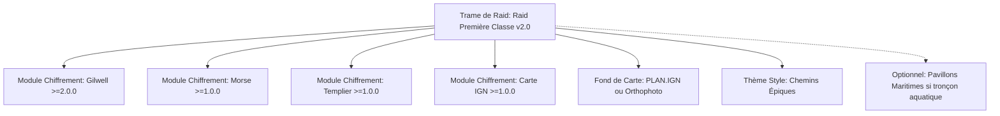
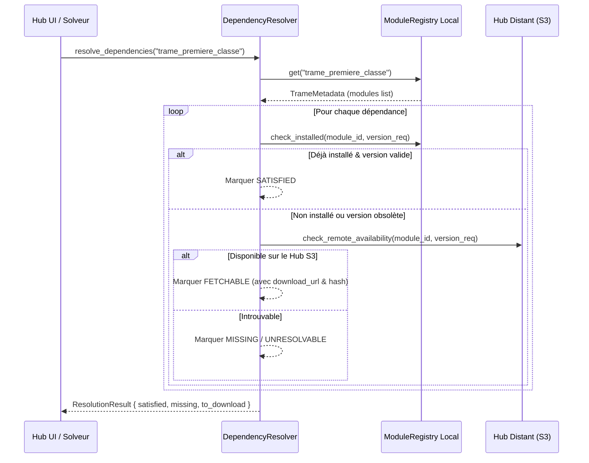

# Spécification Pédagogique : Trames de Raid & Graphe de Dépendances
*Évolution du concept d'« Orchestration » vers les standards scoutes et modélisation du graphe modulaire*

---

## 1. Justification Pédagogique du Renommage : « Orchestrations » $\to$ « Trames de Raid »

### 1.1 Limites du terme « Orchestration »
Le terme *Orchestration* est un jargon informatique (emprunté à Kubernetes, aux architectures orientées services ou aux workflows de calcul). Dans le contexte de l'application ScoutRaider :
- Il est opaque et déconnecté du terrain pour un chef de troupe (CT), un chef de patrouille (CP) ou un intendant.
- Il suggère une simple exécution technique au lieu d'une **démarche éducative de progression scoute**.

### 1.2 Vocabulaire Authentique du Scoutisme
Dans la tradition des Guides et Scouts d'Europe, des Scouts et Guides de France et du scoutisme classique (Baden-Powell, *Carnet de Pistes*), la structure d'un raid ou d'une exploration repose sur des termes consacrés :
- **La Trame de Raid** (ou **Trame Pédagogique**) : C'est le canevas directeur qui cadence l'épreuve. Une trame équilibre les phases d'effort physique (marche, dénivelé), les paliers d'attention technique (lecture de carte IGN, relevé d'azimuts Gilwell, décodage de messages), les temps spirituels (désert, méditation) et le bivouac.
- **Le Parcours / La Piste** : Désigne la concrétisation géographique de la trame sur la carte.

### 1.3 Décision de Conception
Nous adoptons officiellement :
- **Terme principal (UI / Métier)** : **« Trames de Raid »** (forme courte : **« Trames »**).
- **Identifiant technique (Code / API)** : `raid_trame` (alias rétrocompatible : `trame`).
- **Niveaux types standardisés** :
  1. *Trame Exploration & Promesse* (Initiation - Louveteaux / Néo-éclaireurs, 10-15 km).
  2. *Trame Raid de Seconde Classe* (Brevet de patrouille, autonomie 24h, 25 km, croquis topographique et panoramique).
  3. *Trame Raid de Première Classe* (Épreuve d'excellence en autonomie, 35 km, azimuts purs, Gilwell, désert spirituel).
  4. *Trame Grand Raid Raider / Aînés* (Routiers, 50 km+, épreuve d'endurance et de navigation nocturne).

---

## 2. Modélisation du Graphe de Dépendances

Une Trame de Raid n'est pas un simple fichier de configuration statique : c'est un **graphe orienté de dépendances déclaratives**. Pour qu'un carnet de raid généré selon une Trame puisse être compilé et résolu par le solveur CSP (diffraction probabiliste), l'environnement doit disposer de l'ensemble des ressources requises.

### 2.1 Typologie des Dépendances d'une Trame



Une trame déclare 4 types d'exigences :
1. **Modules cryptographiques obligatoires (`required_modules`)** : Nécessaires pour encoder les étapes techniques clés de l'épreuve.
2. **Modules de secours / alternatifs (`fallback_modules`)** : Utilisés si un module obligatoire ne peut pas absorber un tronçon trop court ou trop sinueux.
3. **Fournisseur de carte (`recommended_map`)** : Précise si la trame exige des données vectorielles IGN précises au 1:25 000 ou une carte simplifiée.
4. **Style d'export (`default_theme`)** : Gabarit de carnet recommandé respectant les marges et règles de découpe.

### 2.2 Schéma JSON d'une Trame avec Dépendances

```json
{
  "$schema": "https://scoutraider.org/schemas/v2/trame.schema.json",
  "schema_version": "2.0",
  "id": "trame_premiere_classe",
  "name": "Trame Officielle — Raid de Première Classe",
  "version": "2.0.0",
  "resource_type": "raid_trame",
  "author": "Maîtrise Nationale Éclaireurs",
  "pedagogical_profile": {
    "scout_class": "premiere_classe",
    "target_age_years": [14, 17],
    "max_distance_km": 40.0,
    "min_distance_km": 25.0,
    "max_elevation_gain_m": 850
  },
  "dependencies": {
    "modules": [
      {
        "id": "gilwell",
        "version_req": ">=2.0.0",
        "role": "croquis_route",
        "description": "Indispensable pour l'épreuve de relevé d'azimuts sans carte sur 1 à 2 km.",
        "optional": false
      },
      {
        "id": "morse",
        "version_req": "^1.0.0",
        "role": "transmission",
        "description": "Transmission optique au jalon de mi-parcours.",
        "optional": false
      },
      {
        "id": "templier",
        "version_req": "^1.0.0",
        "role": "meditation",
        "description": "Chiffre pigpen pour l'enveloppe scellée du désert spirituel.",
        "optional": false
      },
      {
        "id": "vigenere",
        "version_req": "*",
        "role": "epreuve_bonus",
        "description": "Épreuve de décryptage au bivouac (max 1 occurrence).",
        "optional": true
      }
    ],
    "map_provider": {
      "id": "PLAN.IGN",
      "required_type": "ign_top25",
      "description": "Cartographie topographique 1:25000 obligatoire pour la sécurité."
    },
    "theme_style": {
      "id": "chemins_epiques",
      "fallback": "standard_scout"
    }
  },
  "diffraction_strategy": {
    "max_written_consecutive": 2,
    "forbid_same_module_consecutive": true,
    "weights_override": {
      "gilwell": 35.0,
      "morse": 20.0,
      "templier": 20.0,
      "texte_clair": 10.0,
      "vigenere": 5.0
    }
  }
}
```

---

## 3. Algorithme de Résolution et Validation du Graphe

Lorsqu'un utilisateur sélectionne une Trame dans le Hub ou que le solveur CSP démarre la génération du carnet, le système exécute l'algorithme suivant :



### 3.1 Règles de Résolution
1. **Validation Stricte SemVer** : Les contraintes telles que `>=2.0.0` ou `^1.0.0` sont évaluées selon les règles du Semantic Versioning.
2. **Détection de Cycles** : Si une ressource déclare une chaîne de dépendances cyclique (ex: A $\to$ B $\to$ A), le graphe est rejeté avec une erreur explicite.
3. **Résolution Automatique Agent/Hub** :
   - Si des modules obligatoires sont marqués `to_download`, l'agent MCP ou le client desktop peut télécharger et valider automatiquement les paquets ZIP depuis S3 sans interruption de l'utilisateur.
   - Si un module obligatoire est `MISSING`, la trame est signalée avec un badge d'avertissement et ne peut être appliquée tant que la dépendance n'est pas satisfaite.
